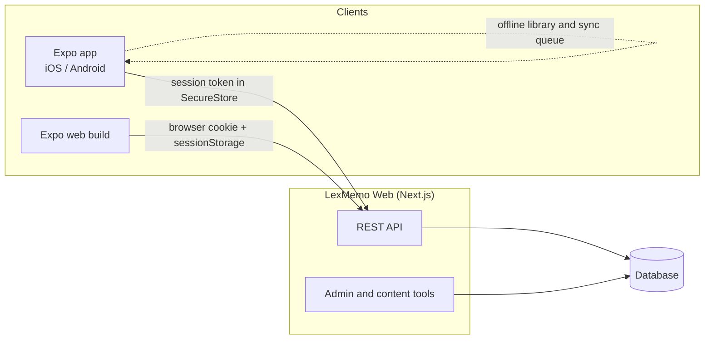

# LexMemo: German vocabulary app

**Mobile app (iOS / Android / web) for learning German words with short daily practice and spaced review.**
Designed, built and shipped end to end by [Volodymyr Anton-Simeon](https://www.linkedin.com/in/volodymyr-anton-simeon-43b4a52b0/).

🌐 Web: [lexmemo.vercel.app](https://lexmemo.vercel.app) (sign-in required) · 📱 App Store / Google Play: release in preparation

> This is a showcase repository. The source code is private. A code walkthrough is available on request.

## What it does

- **Today route:** a daily practice plan with focused practice modes
- **Flashcards:** swipeable cards with haptic feedback, spaced review, streaks and points
- **Library:** browse words by topic, keep your own folders and reviews
- **Offline first:** after sign-in the library is downloaded and practice works offline; progress syncs through a queue when the device is back online
- **Import:** add words from text, documents or photos (camera / photo library) with server-side extraction
- **Audio and reminders:** German speech playback and optional local daily practice reminders
- **Free and Plus tiers:** daily limit for new words on the free plan; Plus adds unlimited words, sync across devices, the web version and import

## Architecture

## Engineering highlights

- **One API for native and web:** native builds send the session in a header and keep it in SecureStore; the web build uses the browser cookie and keeps its token only in `sessionStorage`. In production, CORS is limited to an allowlist of app origins.
- **Offline-first sync:** the library is stored locally; progress changes go into a queue and sync when the server is reachable.
- **Safe server switching:** when the API address changes, the session moves only to the same host or between LAN addresses; any other host requires a new sign-in.
- **Native UX:** stack and tab navigation, a full-screen practice game, a draggable bottom sheet, swipe gestures and haptics.
- **Release readiness:** EAS build profiles for development, preview and production, store listing, privacy policy, QA plan and QA reports.
- **AI-assisted workflow:** built with Claude Code and Codex using agent instruction files; AI-assisted quality audits of word images and translations, reviewed before release.

## Tech stack

**Mobile:** Expo SDK 58 · React Native · TypeScript · SecureStore · Notifications · Camera, Image and Document Picker · Speech  
**Web and API:** Next.js · TypeScript · REST  
**Quality:** TypeScript checks · Jest · Expo Doctor · QA plans and reports  
**Delivery:** EAS Build · Vercel

## Screenshots

Coming soon.

## License

© 2026 Volodymyr Anton-Simeon. All rights reserved. No part of LexMemo may be copied, modified or distributed without written permission.
